# Kairos: Regime-Aware Portfolio Intelligence

Track: Machine Learning (Deep Learning) Investment Strategies, Topic 2: Portfolio Allocation.

## 1. Research Question

Does a machine learning and deep learning driven approach to portfolio allocation, augmented with market regime awareness, produce statistically and economically meaningful improvements in risk-adjusted returns over classical allocation methods, and under what market conditions does this advantage hold or break down?

## 2. Summary of Findings

The research hypothesis is not supported. The highest Sharpe ratio among the Kairos portfolios and the classical benchmarks belongs to Static_60_40. The Sharpe difference of BL_ML_Regime to the best classical benchmark (Static_60_40) is -0.18 (95% interval -0.43 to 0.03, p = 0.135), not statistically significant; BL_ML_Regime is significantly better than 1 and significantly worse than 0 of the 5 classical benchmarks (5% level). For BL_ML_Regime_IC the difference is -0.12 (95% interval -0.34 to 0.05, p = 0.216), not statistically significant.

Regime ablation: the Sharpe difference between BL_ML_Regime and BL_ML_NoRegime is -0.02 (95% interval -0.15 to 0.10, p = 0.762), not statistically significant. In stressed months the regime-aware portfolio's worst-5% average monthly return was -4.25% against -7.05% without regime scaling.

Forecasting: the original stacked ensemble has a mean out-of-sample information coefficient of -0.061. 2 of 9 assets show an IC that is significantly negative at the 5% level (SPY, EFA) and 0 show one that is significantly positive. The original stacked ensemble beats the mean of the single models on 2 of 9 assets.

Overlay ablation: the same stress rule applied to static 60/40 gives a Sharpe ratio of 0.98 against 0.98, with a maximum drawdown of -13.1% against -20.5%.

Diagnosis: the stress-to-return relationship changes sign between the initial training window and later years for 6 of 9 assets, and the R2 against the historical mean is negative under every re-fitted design.

Robustness: 0 of 44 Black-Litterman parameter settings exceed the Sharpe ratio of static 60/40.

Regimes: the walk-forward HMM flags 84% of days inside the documented stress windows and 8% of days inside the calm control windows, against 66% and 7% for the volatility rule.

Forecast repair: the LSTM's dispersion falls from 1.9x to 0.34x realised returns, and the calibrated forecast has a mean R2 of -0.016 against the historical mean. No forecast has a positive mean R2 in either the development or the holdout period.

Prior: BL_ML_Regime adds a significant Sharpe gain over its own prior portfolio for 0 of 3 priors tested.

Crisis window: Regime_60_40 has a maximum drawdown of -16.6% against -29.5% for static 60/40 when 2008 is included.

The specification is frozen as of 2026-07-31 (hash 7864aea1afd47cd0). 0 realised months have been added since then, so there is no confirmatory evidence yet. Re-run with refreshed data to evaluate months as they arrive.

Sharpe ranking: Static_60_40 (0.98), Regime_60_40 (0.98), Market_Reference (0.93), Regime_Market (0.91), BL_HistMean_Regime (0.89), BL_ML_Regime_IC (0.86), BL_ML_NoRegime (0.83), BL_ML_Regime (0.80), Inverse_Vol (0.75), Equal_Weight (0.74), BL_ML_Raw_Regime (0.74), MeanVariance_LW (0.40).

## 3. Data

All prices are daily adjusted closes downloaded from Yahoo Finance through the yfinance library, with the CBOE VIX (^VIX) and the 13-week Treasury bill yield (^IRX) as the volatility and risk-free inputs. No series is simulated, interpolated or reconstructed. The panel is validated before use: history length, gaps, extreme daily moves, and sanity floors on cross-asset correlations (for example SPY and EFA) that would expose substitute or corrupted data. The manifest below records the row count, date range and a file hash for every cached series, so a fresh download can be checked against this run.

| series | file | rows | first | last | sha256 |
|---|---|---|---|---|---|
| SPY | SPY.csv | 5973 | 2003-01-02 | 2026-09-29 | 80b4d77f0fdf48b8 |
| EFA | EFA.csv | 5973 | 2003-01-02 | 2026-09-29 | 39b3ea69d6a93dbd |
| TLT | TLT.csv | 5973 | 2003-01-02 | 2026-09-29 | ed85097271202699 |
| IEF | IEF.csv | 5973 | 2003-01-02 | 2026-09-29 | 61a535deb40e3ff4 |
| HYG | HYG.csv | 4899 | 2007-04-11 | 2026-09-29 | 00df1d44d0692743 |
| GLD | GLD.csv | 5499 | 2004-11-18 | 2026-09-29 | f1fedcc01b7c1e3a |
| DBC | DBC.csv | 5194 | 2006-02-06 | 2026-09-29 | 6517e19cb06ec7bf |
| BTC-USD | BTC_USD.csv | 4396 | 2014-09-17 | 2026-09-29 | 30b7697d99f0ced3 |
| ETH-USD | ETH_USD.csv | 3247 | 2017-11-09 | 2026-09-29 | 576af78f0140bd77 |
| ^VIX | VIX.csv | 5975 | 2003-01-02 | 2026-09-29 | bda63c34eddd5e95 |
| ^IRX | IRX.csv | 5967 | 2003-01-02 | 2026-09-29 | 0a9a840ff93d67f1 |

The investable universe expands over time. An asset enters the portfolio only after it has a valid walk-forward forecast and at least 24 months of return history, so crypto assets enter when they have a usable track record.

## 4. Method

**Features.** About 20 causal technical, volatility, momentum, drawdown and market-beta features per asset, computed from daily prices, plus VIX level, change and z-score. Raw price levels are never used as features. Features are sampled at month end.

**Regimes.** A two-state Gaussian HMM on SPY return, 21-day realised volatility and VIX. It is refit once a year on past data only, and daily states come from the forward filter, so the label on any day uses no later information. A volatility-percentile rule is the comparison method.

**Forecasting.** One-month-ahead log return per asset. Candidates are walk-forward XGBoost, Random Forest and Ridge per asset, an LSTM written in NumPy whose training target is scaled by its training mean and standard deviation, two pooled cross-asset models (ridge and XGBoost, trained on all assets' deviations from their own expanding mean), and the expanding historical mean. The original design stacked the first four models with non-negative weights fit on the previous 24 months (ensemble_stacked). The final forecast stacks all candidates with convex weights (non-negative, summing to one) and then shrinks the result toward the historical mean by the slope of realised on predicted deviations over the previous 36 months, clipped to the range zero to one and set to zero until 24 months exist. The first 48 months are used only for initial training. Skill is judged by the information coefficient, the hit rate against the always-up baseline, and the out-of-sample R2 against the expanding historical mean.

**Forecast diagnostics.** The tree and linear models are re-fitted without the regime features, without all market-wide stress inputs (regime and VIX), with a 72-month initial window, and with the first and last changes combined, and compared on the dates common to all designs. The link between the stress probability and next-month returns is measured separately inside and after the initial window. The LSTM is also re-run without target scaling to measure the effect of the repair.

**Portfolio construction.** Black-Litterman with a Ledoit-Wolf covariance, a prior portfolio, and the calibrated forecasts as absolute views. View uncertainty follows the trailing forecast error variance. In the stressed regime, view uncertainty is multiplied and risk aversion is raised. The optimiser allows cash, so higher risk aversion lowers exposure. BL_ML_Regime_IC additionally scales each view by the asset's trailing IC. BL_ML_NoRegime removes the regime scaling and serves as the ablation. BL_ML_Raw_Regime uses the original uncalibrated stacked forecasts, and BL_HistMean_Regime uses the expanding historical mean as the view.

**Priors.** The default prior is a hand-picked reference allocation. Alternatives are an equal-weight prior and a trailing inverse-volatility prior, which need no judgement, and an observed prior read from `data/raw/prior_weights.csv` when that file exists. Each Black-Litterman portfolio is compared with the portfolio that holds its own prior.

**Benchmarks.** Market reference weights, equal weight, 60/40 (SPY and IEF), inverse volatility, and mean-variance with Ledoit-Wolf covariance. All benchmarks use the same eligible universe as the Black-Litterman portfolios. Regime_60_40 and Regime_Market apply the stress rule mechanically to 60/40 and to the market reference, with no forecasts.

**Backtest.** Monthly rebalancing, 10 basis points on traded notional, weight drift, cash earning the T-bill rate, and Sharpe ratios measured on excess returns over that rate. Significance uses a paired stationary bootstrap of the Sharpe difference, centred on the null. A deflated Sharpe ratio allows for the Kairos variants tried. Sensitivity runs change one Black-Litterman parameter at a time.

**Evaluation windows.** Results are reported for the full sample, for the periods before and from 2019-01-01, and for a crisis-inclusive window with a 24-month initial training period that starts the out-of-sample forecasts before 2008. A specification hash and freeze date are stored so that months realised after the freeze can be evaluated without any re-tuning.

## 5. Results

### 5.1 Regime detection

| Period | Kind | Days_hmm | FlaggedStressed_hmm | Rate_hmm | Days_vol | FlaggedStressed_vol | Rate_vol |
|---|---|---|---|---|---|---|---|
| 2008 Global Financial Crisis | stress | 152 | 152 | 100.0% | 152 | 70 | 46.1% |
| 2011 European Debt Crisis | stress | 66 | 54 | 81.8% | 66 | 54 | 81.8% |
| 2015-2016 China Growth Scare | stress | 131 | 63 | 48.1% | 131 | 82 | 62.6% |
| 2018 Q4 Selloff | stress | 61 | 53 | 86.9% | 61 | 35 | 57.4% |
| 2020 COVID Crash | stress | 35 | 32 | 91.4% | 35 | 32 | 91.4% |
| 2022 Rate-Hiking Selloff | stress | 205 | 191 | 93.2% | 205 | 112 | 54.6% |
| 2013-2014 Calm | calm | 521 | 16 | 3.1% | 521 | 74 | 14.2% |
| 2017 Low Volatility | calm | 259 | 0 | 0.0% | 259 | 13 | 5.0% |
| 2021 Recovery | calm | 197 | 43 | 21.8% | 197 | 3 | 1.5% |

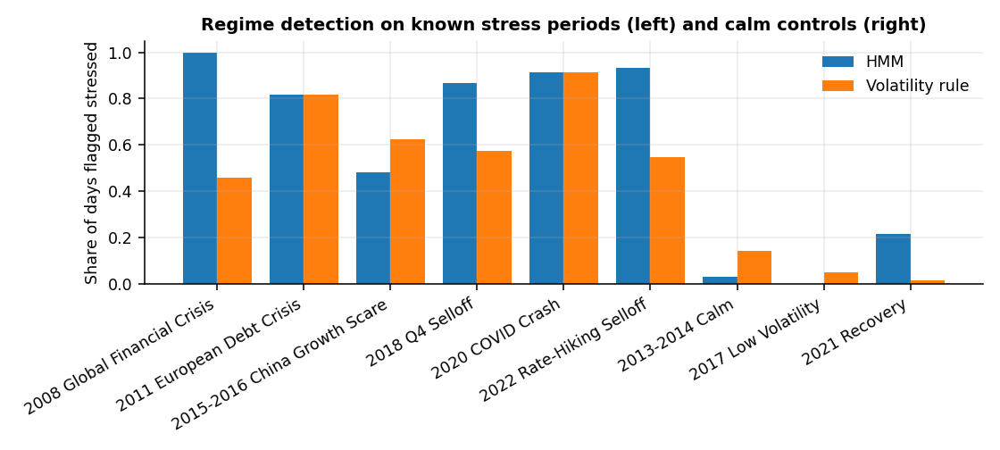

*Share of days flagged stressed*

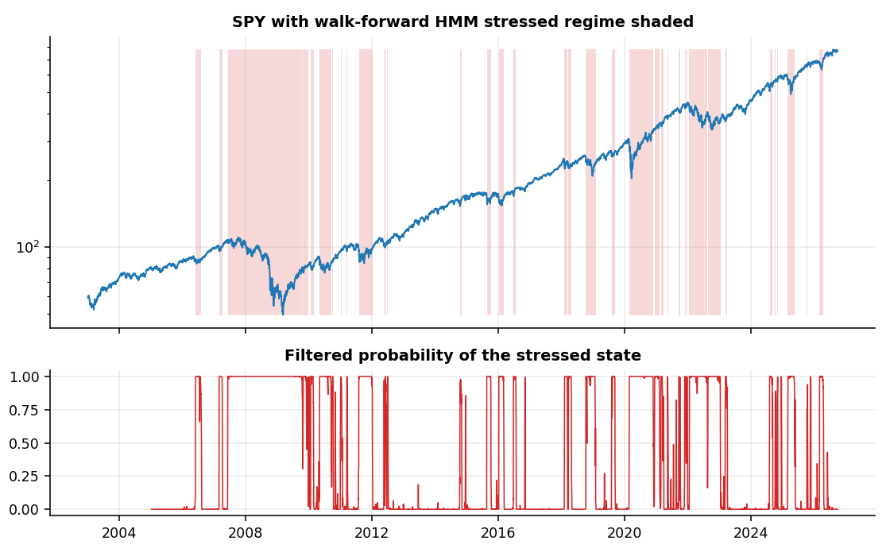

*Walk-forward regime timeline*

### 5.2 Forecasting skill

Out-of-sample information coefficient by asset and model:

| Asset | IC_xgb | IC_rf | IC_ridge | IC_lstm | IC_pooled_ridge | IC_pooled_xgb | IC_ensemble_equal | IC_ensemble_stacked | IC_stack_all | IC_ensemble_final | p_value_stacked |
|---|---|---|---|---|---|---|---|---|---|---|---|
| SPY | -0.047 | -0.106 | -0.128 | -0.131 | -0.075 | -0.108 | -0.141 | -0.189 | -0.203 | -0.118 | 0.006 |
| EFA | -0.151 | -0.163 | -0.215 | -0.071 | -0.075 | -0.070 | -0.206 | -0.167 | -0.176 | -0.241 | 0.015 |
| TLT | -0.036 | 0.039 | -0.042 | 0.054 | -0.027 | -0.081 | 0.000 | -0.103 | -0.147 | -0.067 | 0.138 |
| IEF | 0.113 | 0.063 | -0.049 | 0.003 | -0.011 | -0.094 | 0.078 | -0.038 | -0.039 | -0.074 | 0.580 |
| HYG | 0.081 | 0.106 | -0.051 | 0.015 | -0.010 | 0.018 | 0.107 | -0.006 | 0.058 | -0.061 | 0.935 |
| GLD | 0.041 | 0.029 | -0.104 | -0.024 | -0.094 | -0.028 | 0.019 | 0.067 | -0.075 | -0.133 | 0.344 |
| DBC | 0.047 | 0.038 | 0.094 | -0.032 | -0.013 | -0.040 | 0.069 | -0.022 | -0.046 | -0.078 | 0.768 |
| BTC-USD | -0.110 | -0.122 | -0.093 | -0.187 | -0.135 | -0.122 | -0.180 | -0.206 | -0.105 | -0.047 | 0.062 |
| ETH-USD | -0.029 | 0.018 | -0.145 | 0.212 | -0.100 | 0.064 | 0.135 | 0.111 | -0.080 | -0.147 | 0.462 |

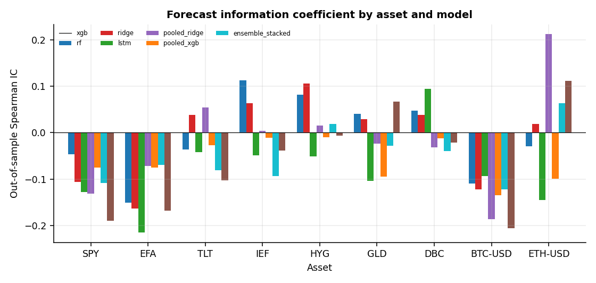

*Out-of-sample IC by asset and model*

Hit rate against the always-up baseline and R2 against the historical mean (HitEdge is the hit rate minus the share of up months):

| Asset | BaseRate | UpShare_stacked | Hit_ensemble_stacked | HitEdge_ensemble_stacked | IC_ensemble_stacked | R2OOS_ensemble_stacked | R2OOS_ensemble_final | R2OOS_xgb | R2OOS_rf | R2OOS_ridge | R2OOS_lstm | R2OOS_pooled_ridge | R2OOS_pooled_xgb |
|---|---|---|---|---|---|---|---|---|---|---|---|---|---|
| SPY | 0.687 | 0.815 | 0.602 | -0.085 | -0.189 | -0.163 | -0.005 | -0.262 | -0.175 | -0.052 | -0.134 | -0.054 | -0.179 |
| EFA | 0.616 | 0.616 | 0.403 | -0.213 | -0.167 | -0.105 | -0.010 | -0.342 | -0.253 | -0.029 | -0.120 | -0.074 | -0.196 |
| TLT | 0.507 | 0.555 | 0.355 | -0.152 | -0.103 | -0.154 | -0.003 | -0.188 | -0.078 | -0.070 | -0.052 | -0.068 | -0.034 |
| IEF | 0.521 | 0.763 | 0.445 | -0.076 | -0.038 | -0.065 | -0.018 | -0.060 | -0.045 | -0.033 | -0.117 | -0.149 | -0.075 |
| HYG | 0.665 | 0.861 | 0.595 | -0.069 | -0.006 | -0.100 | -0.043 | -0.095 | -0.101 | -0.304 | -0.247 | -0.111 | 0.030 |
| GLD | 0.512 | 0.721 | 0.448 | -0.065 | 0.067 | -0.031 | -0.022 | -0.148 | -0.068 | -0.003 | -0.059 | -0.039 | -0.066 |
| DBC | 0.524 | 0.406 | 0.449 | -0.075 | -0.022 | -0.139 | -0.040 | -0.179 | -0.076 | -0.017 | -0.111 | -0.044 | -0.020 |
| BTC-USD | 0.554 | 0.759 | 0.398 | -0.157 | -0.206 | -0.079 | 0.000 | -0.294 | -0.162 | -0.013 | -0.288 | -0.055 | -0.227 |
| ETH-USD | 0.457 | 0.870 | 0.413 | -0.043 | 0.111 | -0.026 | 0.000 | -0.329 | -0.087 | 0.000 | -0.306 | 0.005 | -0.075 |

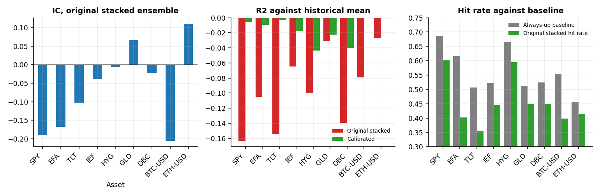

*Forecast skill by asset*

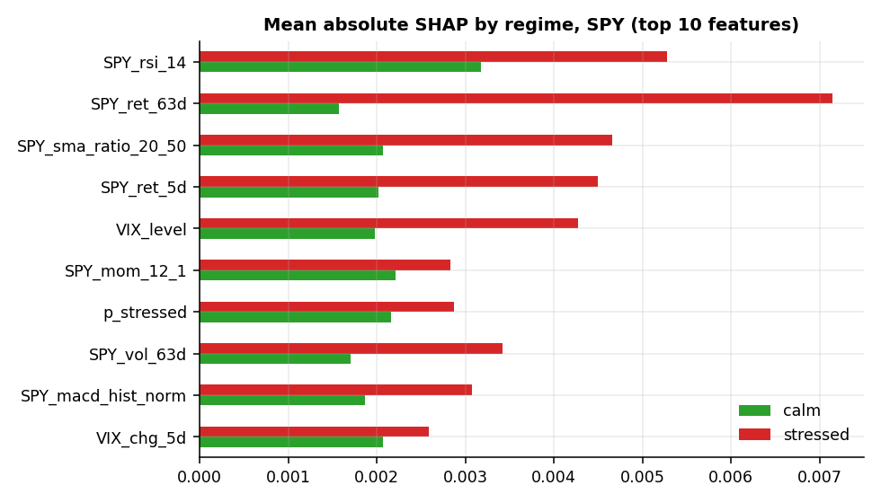

*Regime-conditional SHAP importance (in-sample, for explanation only)*

### 5.3 Diagnosing the information coefficient

Rank correlation between the filtered stress probability and the next-month return, inside and after the initial training window:

| Asset | Window | n | CorrStressNextRet | MeanRetStressed | MeanRetCalm | StressedMonths |
|---|---|---|---|---|---|---|
| BTC-USD | initial_window | 48 | -0.151 | -0.033 | 0.106 | 11 |
| BTC-USD | after | 83 | 0.186 | 0.060 | 0.006 | 32 |
| DBC | initial_window | 48 | -0.143 | 0.003 | 0.012 | 39 |
| DBC | after | 187 | 0.173 | 0.004 | 0.000 | 51 |
| EFA | initial_window | 48 | -0.324 | -0.024 | 0.016 | 24 |
| EFA | after | 211 | 0.198 | 0.015 | 0.003 | 69 |
| ETH-USD | initial_window | 48 | 0.043 | 0.045 | 0.040 | 28 |
| ETH-USD | after | 46 | 0.318 | 0.092 | -0.010 | 9 |
| GLD | initial_window | 48 | -0.030 | 0.017 | 0.021 | 34 |
| GLD | after | 201 | 0.120 | 0.006 | 0.006 | 59 |
| HYG | initial_window | 48 | 0.025 | 0.008 | 0.002 | 33 |
| HYG | after | 173 | 0.079 | 0.004 | 0.004 | 46 |
| IEF | initial_window | 48 | 0.188 | 0.011 | 0.000 | 24 |
| IEF | after | 211 | 0.010 | 0.001 | 0.002 | 69 |
| SPY | initial_window | 48 | -0.228 | -0.020 | 0.008 | 24 |
| SPY | after | 211 | 0.206 | 0.018 | 0.009 | 69 |
| TLT | initial_window | 48 | 0.070 | 0.013 | -0.001 | 24 |
| TLT | after | 211 | -0.055 | -0.001 | 0.003 | 69 |

Tree and linear models re-fitted under alternative designs, compared on common dates:

| Variant | MeanIC | MeanIC_equities | MeanR2OOS | AssetsPositiveIC | Assets |
|---|---|---|---|---|---|
| as_specified | -0.011 | -0.064 | -0.065 | 3 | 9 |
| no_regime_features | -0.020 | -0.093 | -0.066 | 4 | 9 |
| no_stress_features | 0.002 | -0.084 | -0.058 | 5 | 9 |
| longer_initial_window | -0.011 | -0.064 | -0.065 | 3 | 9 |
| no_regime_longer_window | -0.020 | -0.093 | -0.066 | 4 | 9 |

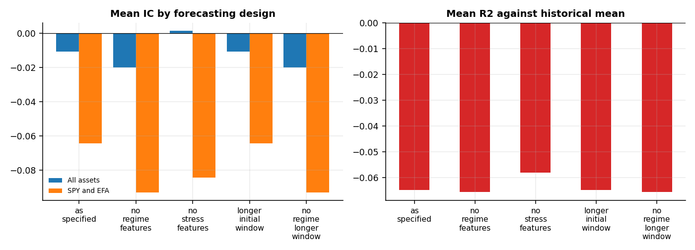

*Mean IC by forecasting design*

### 5.4 Repairing the forecasts

LSTM before and after scaling the training target (Disp is the standard deviation of forecasts divided by that of realised returns):

| Asset | n_oos | Disp_raw | R2OOS_raw | IC_raw | Disp_fixed | R2OOS_fixed | IC_fixed |
|---|---|---|---|---|---|---|---|
| BTC-USD | 83 | 0.908 | -1.143 | -0.153 | 0.376 | -0.288 | -0.187 |
| DBC | 187 | 1.572 | -2.559 | -0.020 | 0.342 | -0.111 | -0.032 |
| EFA | 211 | 2.058 | -3.442 | -0.022 | 0.324 | -0.120 | -0.071 |
| ETH-USD | 46 | 1.079 | -1.190 | 0.252 | 0.513 | -0.306 | 0.212 |
| GLD | 201 | 1.505 | -2.778 | -0.106 | 0.280 | -0.059 | -0.024 |
| HYG | 173 | 2.530 | -6.711 | -0.041 | 0.445 | -0.247 | 0.015 |
| IEF | 211 | 2.642 | -6.947 | 0.035 | 0.273 | -0.117 | 0.003 |
| SPY | 211 | 2.088 | -3.751 | 0.007 | 0.307 | -0.134 | -0.131 |
| TLT | 211 | 2.394 | -5.792 | 0.035 | 0.242 | -0.052 | 0.054 |

Mean information coefficient and mean R2 against the historical mean, by forecast and period:

| Forecast | MeanIC (full) | MeanIC (development) | MeanIC (holdout) | MeanR2OOS (full) | MeanR2OOS (development) | MeanR2OOS (holdout) |
|---|---|---|---|---|---|---|
| xgb | -0.010 | 0.000 | -0.012 | -0.211 | -0.234 | -0.160 |
| rf | -0.011 | -0.005 | -0.023 | -0.116 | -0.128 | -0.095 |
| ridge | -0.081 | -0.073 | -0.138 | -0.058 | -0.202 | -0.004 |
| lstm | -0.018 | 0.011 | -0.051 | -0.159 | -0.119 | -0.168 |
| pooled_ridge | -0.060 | 0.004 | -0.098 | -0.066 | -0.100 | -0.050 |
| pooled_xgb | -0.051 | -0.055 | -0.059 | -0.094 | -0.147 | -0.038 |
| ensemble_equal | -0.013 | 0.017 | -0.033 | -0.064 | -0.067 | -0.054 |
| ensemble_stacked | -0.061 | -0.035 | -0.100 | -0.096 | -0.107 | -0.093 |
| stack_all | -0.090 | -0.082 | -0.113 | -0.054 | -0.066 | -0.053 |
| ensemble_final | -0.107 | -0.145 | -0.136 | -0.016 | -0.025 | -0.014 |

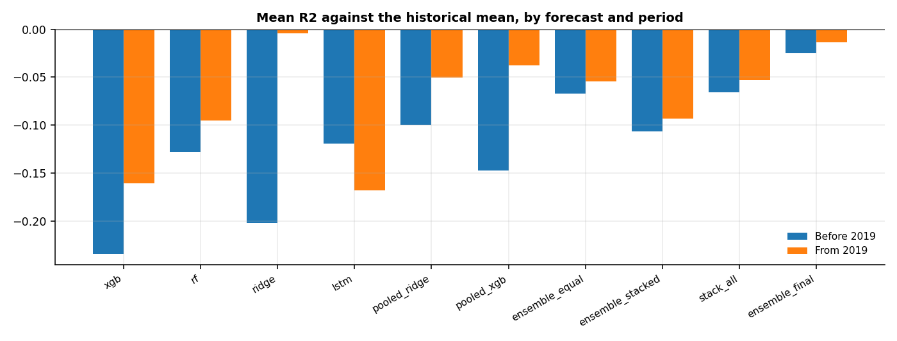

*R2 against the historical mean by forecast and period*

Average stacking weight of each candidate in the final forecast:

| Asset | xgb | rf | ridge | lstm | pooled_ridge | pooled_xgb | hist_mean |
|---|---|---|---|---|---|---|---|
| SPY | 0.16 | 0.02 | 0.11 | 0.09 | 0.21 | 0.10 | 0.31 |
| EFA | 0.08 | 0.01 | 0.01 | 0.23 | 0.26 | 0.16 | 0.25 |
| TLT | 0.11 | 0.11 | 0.03 | 0.20 | 0.20 | 0.16 | 0.19 |
| IEF | 0.22 | 0.19 | 0.10 | 0.08 | 0.13 | 0.13 | 0.14 |
| HYG | 0.10 | 0.21 | 0.04 | 0.08 | 0.02 | 0.35 | 0.20 |
| GLD | 0.13 | 0.13 | 0.03 | 0.18 | 0.15 | 0.17 | 0.21 |
| DBC | 0.11 | 0.01 | 0.16 | 0.19 | 0.15 | 0.12 | 0.26 |
| BTC-USD | 0.03 | 0.04 | 0.00 | 0.00 | 0.20 | 0.00 | 0.72 |
| ETH-USD | 0.16 | 0.01 | 0.00 | 0.37 | 0.37 | 0.05 | 0.04 |

### 5.5 Portfolio performance

| index | AnnReturn | AnnVol | Sharpe | Sortino | MaxDrawdown | Calmar | CVaR5 | AnnTurnover |
|---|---|---|---|---|---|---|---|---|
| BL_ML_Regime | 7.35% | 7.50% | 0.805 | 1.281 | -16.14% | 0.455 | -4.10% | 2.12 |
| BL_ML_Regime_IC | 7.37% | 7.00% | 0.859 | 1.363 | -13.12% | 0.562 | -3.75% | 1.32 |
| BL_ML_NoRegime | 9.02% | 9.38% | 0.825 | 1.331 | -22.69% | 0.398 | -5.50% | 1.86 |
| BL_ML_Raw_Regime | 7.15% | 7.90% | 0.744 | 1.145 | -17.16% | 0.416 | -4.85% | 4.05 |
| BL_HistMean_Regime | 7.96% | 7.38% | 0.894 | 1.458 | -15.31% | 0.520 | -3.89% | 1.34 |
| Market_Reference | 10.39% | 9.74% | 0.927 | 1.519 | -21.06% | 0.494 | -5.56% | 0.35 |
| Equal_Weight | 9.49% | 11.25% | 0.744 | 1.300 | -23.59% | 0.402 | -5.89% | 0.54 |
| Static_60_40 | 10.37% | 9.12% | 0.980 | 1.596 | -20.52% | 0.505 | -5.19% | 0.27 |
| Inverse_Vol | 6.64% | 7.13% | 0.749 | 1.185 | -17.73% | 0.374 | -4.19% | 0.46 |
| MeanVariance_LW | 6.00% | 13.28% | 0.402 | 0.617 | -36.97% | 0.162 | -8.11% | 2.52 |
| Regime_60_40 | 8.23% | 6.95% | 0.980 | 1.552 | -13.15% | 0.626 | -3.86% | 1.19 |
| Regime_Market | 8.12% | 7.42% | 0.910 | 1.456 | -13.62% | 0.597 | -3.99% | 1.25 |

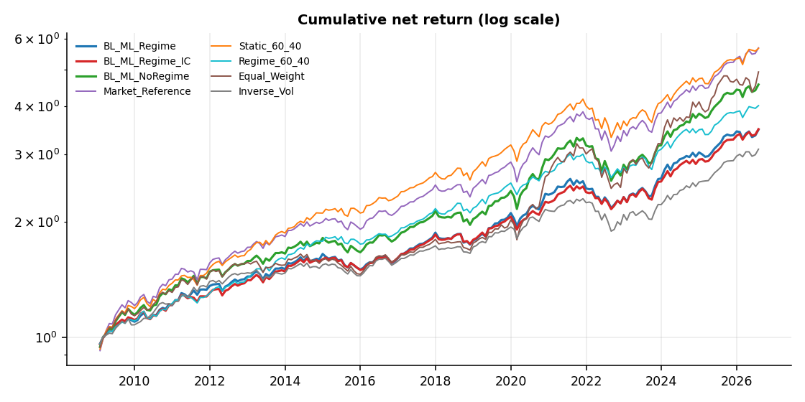

*Cumulative net return*

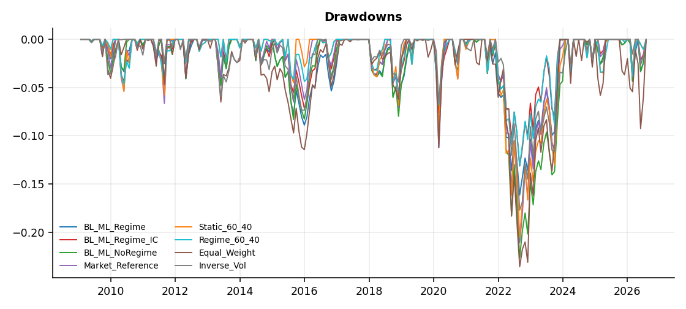

*Drawdowns*

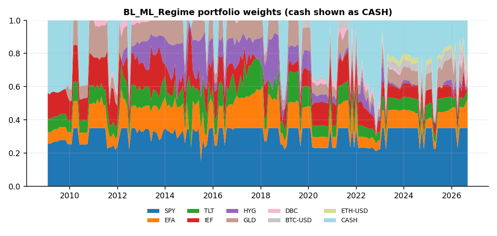

*Portfolio weights*

### 5.6 Statistical significance

| strategy | benchmark | diff | ci_low | ci_high | p_value |
|---|---|---|---|---|---|
| BL_ML_Regime | BL_ML_Regime_IC | -0.054 | -0.179 | 0.067 | 0.387 |
| BL_ML_Regime | BL_ML_NoRegime | -0.020 | -0.150 | 0.099 | 0.762 |
| BL_ML_Regime | BL_ML_Raw_Regime | 0.061 | -0.103 | 0.221 | 0.465 |
| BL_ML_Regime | BL_HistMean_Regime | -0.089 | -0.149 | -0.039 | 0.003 |
| BL_ML_Regime | Market_Reference | -0.122 | -0.309 | 0.040 | 0.175 |
| BL_ML_Regime | Equal_Weight | 0.061 | -0.155 | 0.302 | 0.591 |
| BL_ML_Regime | Static_60_40 | -0.176 | -0.427 | 0.030 | 0.135 |
| BL_ML_Regime | Inverse_Vol | 0.056 | -0.198 | 0.270 | 0.630 |
| BL_ML_Regime | MeanVariance_LW | 0.403 | 0.102 | 0.712 | 0.012 |
| BL_ML_Regime | Regime_60_40 | -0.175 | -0.412 | 0.031 | 0.123 |
| BL_ML_Regime | Regime_Market | -0.105 | -0.243 | 0.026 | 0.130 |
| BL_ML_Regime_IC | BL_ML_Regime | 0.054 | -0.067 | 0.179 | 0.387 |
| BL_ML_Regime_IC | BL_ML_NoRegime | 0.034 | -0.132 | 0.191 | 0.683 |
| BL_ML_Regime_IC | BL_ML_Raw_Regime | 0.115 | -0.087 | 0.308 | 0.253 |
| BL_ML_Regime_IC | BL_HistMean_Regime | -0.035 | -0.141 | 0.075 | 0.541 |
| BL_ML_Regime_IC | Market_Reference | -0.068 | -0.197 | 0.046 | 0.291 |
| BL_ML_Regime_IC | Equal_Weight | 0.115 | -0.131 | 0.402 | 0.388 |
| BL_ML_Regime_IC | Static_60_40 | -0.121 | -0.338 | 0.049 | 0.216 |
| BL_ML_Regime_IC | Inverse_Vol | 0.110 | -0.144 | 0.336 | 0.365 |
| BL_ML_Regime_IC | MeanVariance_LW | 0.457 | 0.101 | 0.814 | 0.013 |
| BL_ML_Regime_IC | Regime_60_40 | -0.121 | -0.307 | 0.039 | 0.173 |
| BL_ML_Regime_IC | Regime_Market | -0.051 | -0.083 | -0.025 | 0.002 |
| Regime_60_40 | Static_60_40 | -0.001 | -0.137 | 0.125 | 0.994 |
| Regime_Market | Market_Reference | -0.017 | -0.143 | 0.098 | 0.795 |
| Regime_60_40 | BL_ML_Regime | 0.175 | -0.031 | 0.412 | 0.123 |
| Regime_Market | BL_ML_Regime | 0.105 | -0.026 | 0.243 | 0.130 |

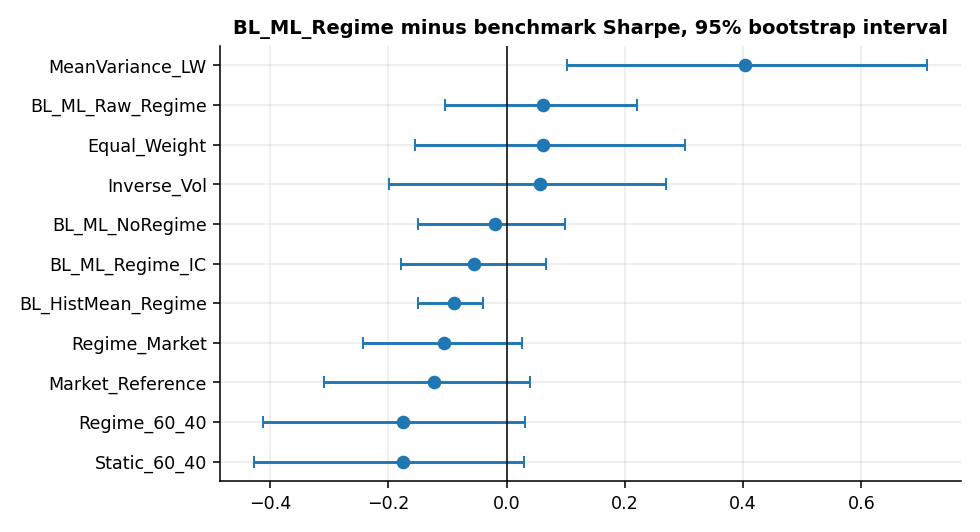

*Sharpe difference with 95% bootstrap interval*

Deflated Sharpe ratio of the Kairos variants (DSR is the probability that the true Sharpe ratio is positive after allowing for the number of trials):

| strategy | Sharpe | BenchmarkSharpe | DSR | Trials |
|---|---|---|---|---|
| BL_ML_Regime | 0.805 | 0.068 | 0.998 | 5 |
| BL_ML_Regime | 0.805 | 0.089 | 0.998 | 10 |
| BL_ML_Regime_IC | 0.859 | 0.068 | 0.999 | 5 |
| BL_ML_Regime_IC | 0.859 | 0.089 | 0.999 | 10 |
| BL_ML_NoRegime | 0.825 | 0.068 | 0.999 | 5 |
| BL_ML_NoRegime | 0.825 | 0.089 | 0.998 | 10 |

### 5.7 Overlay ablation

| index | AnnReturn | AnnVol | Sharpe | Sortino | MaxDrawdown | Calmar | CVaR5 | AnnTurnover |
|---|---|---|---|---|---|---|---|---|
| BL_ML_Regime | 7.35% | 7.50% | 0.805 | 1.281 | -16.14% | 0.455 | -4.10% | 2.12 |
| BL_ML_Regime_IC | 7.37% | 7.00% | 0.859 | 1.363 | -13.12% | 0.562 | -3.75% | 1.32 |
| BL_ML_Raw_Regime | 7.15% | 7.90% | 0.744 | 1.145 | -17.16% | 0.416 | -4.85% | 4.05 |
| BL_HistMean_Regime | 7.96% | 7.38% | 0.894 | 1.458 | -15.31% | 0.520 | -3.89% | 1.34 |
| Regime_60_40 | 8.23% | 6.95% | 0.980 | 1.552 | -13.15% | 0.626 | -3.86% | 1.19 |
| Static_60_40 | 10.37% | 9.12% | 0.980 | 1.596 | -20.52% | 0.505 | -5.19% | 0.27 |
| Regime_Market | 8.12% | 7.42% | 0.910 | 1.456 | -13.62% | 0.597 | -3.99% | 1.25 |
| Market_Reference | 10.39% | 9.74% | 0.927 | 1.519 | -21.06% | 0.494 | -5.56% | 0.35 |

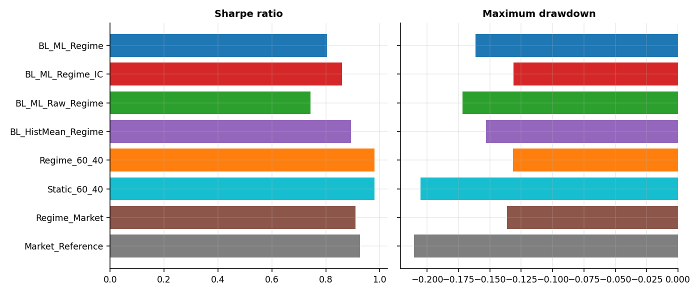

*Forecast-driven portfolios against mechanical overlays*

### 5.8 Performance by regime

| index | AnnReturn | Sharpe | MaxDrawdown | CVaR5 | Months |
|---|---|---|---|---|---|
| BL_ML_Regime / All | 7.35% | 0.805 | -16.14% | -4.10% | 211 |
| BL_ML_Regime / Calm | 6.71% | 0.696 | -11.68% | -3.86% | 142 |
| BL_ML_Regime / Stressed | 8.68% | 1.032 | -11.17% | -4.25% | 69 |
| BL_ML_Regime_IC / All | 7.37% | 0.859 | -13.12% | -3.75% | 211 |
| BL_ML_Regime_IC / Calm | 6.64% | 0.736 | -10.18% | -3.61% | 142 |
| BL_ML_Regime_IC / Stressed | 8.88% | 1.111 | -9.71% | -3.89% | 69 |
| BL_ML_NoRegime / All | 9.02% | 0.825 | -22.69% | -5.50% | 211 |
| BL_ML_NoRegime / Calm | 6.77% | 0.703 | -11.59% | -3.86% | 142 |
| BL_ML_NoRegime / Stressed | 13.81% | 1.039 | -19.05% | -7.05% | 69 |
| BL_ML_Raw_Regime / All | 7.15% | 0.744 | -17.16% | -4.85% | 211 |
| BL_ML_Raw_Regime / Calm | 7.13% | 0.693 | -11.31% | -4.76% | 142 |
| BL_ML_Raw_Regime / Stressed | 7.17% | 0.866 | -11.48% | -4.66% | 69 |
| BL_HistMean_Regime / All | 7.96% | 0.894 | -15.31% | -3.89% | 211 |
| BL_HistMean_Regime / Calm | 7.32% | 0.786 | -10.91% | -3.65% | 142 |
| BL_HistMean_Regime / Stressed | 9.29% | 1.115 | -10.92% | -4.06% | 69 |
| Market_Reference / All | 10.39% | 0.927 | -21.06% | -5.56% | 211 |
| Market_Reference / Calm | 7.60% | 0.816 | -10.56% | -3.88% | 142 |
| Market_Reference / Stressed | 16.38% | 1.147 | -18.30% | -7.35% | 69 |
| Equal_Weight / All | 9.49% | 0.744 | -23.59% | -5.89% | 211 |
| Equal_Weight / Calm | 5.70% | 0.471 | -13.24% | -4.20% | 142 |
| Equal_Weight / Stressed | 17.72% | 1.169 | -21.16% | -7.46% | 69 |
| Static_60_40 / All | 10.37% | 0.980 | -20.52% | -5.19% | 211 |
| Static_60_40 / Calm | 8.04% | 0.922 | -9.97% | -3.84% | 142 |
| Static_60_40 / Stressed | 15.34% | 1.141 | -17.20% | -6.81% | 69 |
| Inverse_Vol / All | 6.64% | 0.749 | -17.73% | -4.19% | 211 |
| Inverse_Vol / Calm | 5.53% | 0.675 | -8.59% | -2.92% | 142 |
| Inverse_Vol / Stressed | 8.95% | 0.885 | -16.06% | -5.29% | 69 |
| MeanVariance_LW / All | 6.00% | 0.402 | -36.97% | -8.11% | 211 |
| MeanVariance_LW / Calm | 3.88% | 0.256 | -21.24% | -7.21% | 142 |
| MeanVariance_LW / Stressed | 10.48% | 0.628 | -31.61% | -8.96% | 69 |
| Regime_60_40 / All | 8.23% | 0.980 | -13.15% | -3.86% | 211 |
| Regime_60_40 / Calm | 7.96% | 0.912 | -10.08% | -3.85% | 142 |
| Regime_60_40 / Stressed | 8.80% | 1.117 | -9.44% | -3.75% | 69 |
| Regime_Market / All | 8.12% | 0.910 | -13.62% | -3.99% | 211 |
| Regime_Market / Calm | 7.52% | 0.806 | -10.67% | -3.88% | 142 |
| Regime_Market / Stressed | 9.38% | 1.124 | -10.09% | -4.05% | 69 |

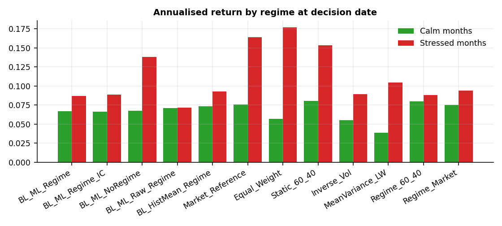

*Annualised return by regime*

### 5.9 Other evaluation windows

Performance before and from 2019-01-01:

| index | AnnReturn | AnnVol | Sharpe | MaxDrawdown | Months |
|---|---|---|---|---|---|
| BL_ML_Regime / development | 5.98% | 6.37% | 0.885 | -8.90% | 120 |
| BL_ML_Regime / holdout | 9.19% | 8.77% | 0.743 | -16.14% | 91 |
| BL_ML_Regime_IC / development | 6.03% | 6.05% | 0.938 | -7.15% | 120 |
| BL_ML_Regime_IC / holdout | 9.16% | 8.10% | 0.794 | -13.12% | 91 |
| BL_ML_NoRegime / development | 7.36% | 7.56% | 0.929 | -8.32% | 120 |
| BL_ML_NoRegime / holdout | 11.24% | 11.35% | 0.761 | -22.69% | 91 |
| BL_ML_Raw_Regime / development | 6.03% | 6.70% | 0.852 | -7.76% | 120 |
| BL_ML_Raw_Regime / holdout | 8.63% | 9.26% | 0.654 | -17.16% | 91 |
| BL_HistMean_Regime / development | 6.66% | 6.18% | 1.015 | -6.57% | 120 |
| BL_HistMean_Regime / holdout | 9.70% | 8.73% | 0.800 | -15.31% | 91 |
| Market_Reference / development | 9.36% | 8.39% | 1.066 | -7.06% | 120 |
| Market_Reference / holdout | 11.77% | 11.31% | 0.806 | -21.06% | 91 |
| Equal_Weight / development | 5.83% | 7.36% | 0.757 | -11.45% | 120 |
| Equal_Weight / holdout | 14.52% | 14.84% | 0.809 | -23.59% | 91 |
| Static_60_40 / development | 10.45% | 7.59% | 1.302 | -6.86% | 120 |
| Static_60_40 / holdout | 10.27% | 10.86% | 0.709 | -20.52% | 91 |
| Inverse_Vol / development | 5.57% | 5.94% | 0.882 | -7.37% | 120 |
| Inverse_Vol / holdout | 8.06% | 8.47% | 0.643 | -17.73% | 91 |
| MeanVariance_LW / development | 4.75% | 8.24% | 0.560 | -10.80% | 120 |
| MeanVariance_LW / holdout | 7.67% | 17.92% | 0.351 | -36.97% | 91 |
| Regime_60_40 / development | 8.07% | 5.77% | 1.310 | -5.63% | 120 |
| Regime_60_40 / holdout | 8.46% | 8.28% | 0.700 | -13.15% | 91 |
| Regime_Market / development | 6.93% | 6.40% | 1.023 | -7.50% | 120 |
| Regime_Market / holdout | 9.72% | 8.59% | 0.814 | -13.62% | 91 |

Paired Sharpe comparisons within each period:

| period | strategy | benchmark | diff | ci_low | ci_high | p_value |
|---|---|---|---|---|---|---|
| development | BL_ML_Regime | Static_60_40 | -0.417 | -0.808 | -0.099 | 0.027 |
| development | BL_ML_Regime | Regime_60_40 | -0.425 | -0.782 | -0.107 | 0.013 |
| development | BL_ML_Regime | BL_HistMean_Regime | -0.130 | -0.238 | -0.037 | 0.013 |
| development | BL_ML_Regime | BL_ML_Raw_Regime | 0.033 | -0.194 | 0.246 | 0.772 |
| development | Regime_60_40 | Static_60_40 | 0.009 | -0.157 | 0.167 | 0.920 |
| holdout | BL_ML_Regime | Static_60_40 | 0.034 | -0.245 | 0.262 | 0.779 |
| holdout | BL_ML_Regime | Regime_60_40 | 0.043 | -0.187 | 0.272 | 0.721 |
| holdout | BL_ML_Regime | BL_HistMean_Regime | -0.057 | -0.098 | -0.017 | 0.006 |
| holdout | BL_ML_Regime | BL_ML_Raw_Regime | 0.089 | -0.143 | 0.323 | 0.445 |
| holdout | Regime_60_40 | Static_60_40 | -0.009 | -0.206 | 0.153 | 0.924 |

Crisis-inclusive window (out-of-sample forecasts start before 2008):

| index | Sharpe_main | Sharpe_crisis_window | MaxDD_main | MaxDD_crisis_window | Months_main | Months_crisis_window |
|---|---|---|---|---|---|---|
| BL_ML_Regime | 0.805 | 0.691 | -0.161 | -0.172 | 211 | 235 |
| BL_ML_Regime_IC | 0.859 | 0.700 | -0.131 | -0.169 | 211 | 235 |
| BL_ML_NoRegime | 0.825 | 0.658 | -0.227 | -0.264 | 211 | 235 |
| BL_ML_Raw_Regime | 0.744 | 0.770 | -0.172 | -0.185 | 211 | 235 |
| BL_HistMean_Regime | 0.894 | 0.759 | -0.153 | -0.172 | 211 | 235 |
| Market_Reference | 0.927 | 0.689 | -0.211 | -0.314 | 211 | 235 |
| Equal_Weight | 0.744 | 0.696 | -0.236 | -0.287 | 211 | 235 |
| Static_60_40 | 0.980 | 0.717 | -0.205 | -0.295 | 211 | 235 |
| Inverse_Vol | 0.749 | 0.671 | -0.177 | -0.185 | 211 | 235 |
| MeanVariance_LW | 0.402 | 0.391 | -0.370 | -0.469 | 211 | 235 |
| Regime_60_40 | 0.980 | 0.774 | -0.131 | -0.166 | 211 | 235 |
| Regime_Market | 0.910 | 0.737 | -0.136 | -0.178 | 211 | 235 |

| strategy | benchmark | diff | ci_low | ci_high | p_value |
|---|---|---|---|---|---|
| BL_ML_Regime | Static_60_40 | -0.026 | -0.289 | 0.195 | 0.821 |
| BL_ML_Regime | Regime_60_40 | -0.083 | -0.307 | 0.113 | 0.430 |
| Regime_60_40 | Static_60_40 | 0.056 | -0.094 | 0.187 | 0.433 |

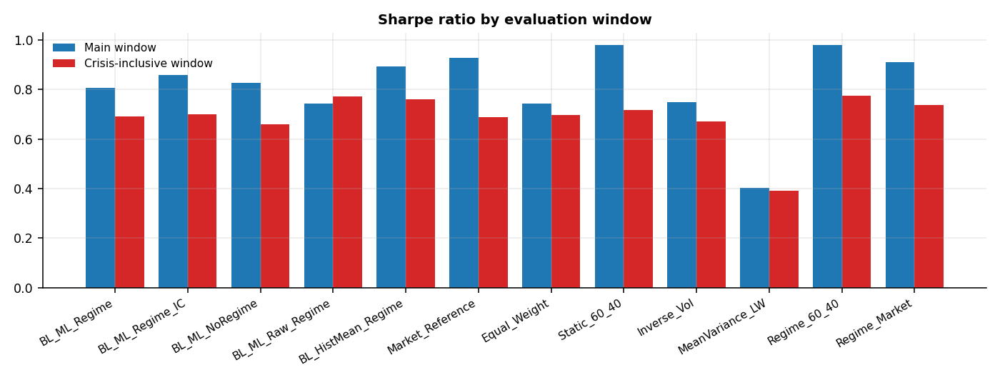

*Sharpe ratio by evaluation window*

### 5.10 Robustness

Sharpe ratio by transaction cost assumption:

| index | 0bps | 10bps | 25bps | 50bps |
|---|---|---|---|---|
| BL_ML_Regime | 0.834 | 0.805 | 0.761 | 0.688 |
| BL_ML_Regime_IC | 0.879 | 0.859 | 0.830 | 0.780 |
| BL_ML_NoRegime | 0.846 | 0.825 | 0.794 | 0.742 |
| BL_ML_Raw_Regime | 0.795 | 0.744 | 0.667 | 0.538 |
| BL_HistMean_Regime | 0.913 | 0.894 | 0.866 | 0.818 |
| Market_Reference | 0.931 | 0.927 | 0.921 | 0.911 |
| Equal_Weight | 0.749 | 0.744 | 0.736 | 0.724 |
| Static_60_40 | 0.984 | 0.980 | 0.975 | 0.967 |
| Inverse_Vol | 0.756 | 0.749 | 0.738 | 0.721 |
| MeanVariance_LW | 0.421 | 0.402 | 0.374 | 0.326 |
| Regime_60_40 | 0.998 | 0.980 | 0.953 | 0.908 |
| Regime_Market | 0.928 | 0.910 | 0.884 | 0.840 |

Sharpe ratio by half of the sample:

| index | FirstHalfSharpe | SecondHalfSharpe |
|---|---|---|
| BL_ML_Regime | 1.062 | 0.635 |
| BL_ML_Regime_IC | 1.094 | 0.694 |
| BL_ML_NoRegime | 1.096 | 0.664 |
| BL_ML_Raw_Regime | 1.059 | 0.537 |
| BL_HistMean_Regime | 1.180 | 0.711 |
| Market_Reference | 1.200 | 0.731 |
| Equal_Weight | 0.856 | 0.733 |
| Static_60_40 | 1.473 | 0.663 |
| Inverse_Vol | 1.002 | 0.573 |
| MeanVariance_LW | 0.675 | 0.308 |
| Regime_60_40 | 1.488 | 0.660 |
| Regime_Market | 1.171 | 0.728 |

Black-Litterman parameter sensitivity, one parameter changed at a time:

| Parameter | Value | Default | Variant | Sharpe | MaxDrawdown | AnnTurnover | AvgCash |
|---|---|---|---|---|---|---|---|
| tau | 0.025 |  | BL_ML_Regime | 0.840 | -14.86% | 1.70 | 15.6% |
| tau | 0.025 |  | BL_ML_Regime_IC | 0.859 | -13.26% | 1.26 | 17.4% |
| tau | 0.05 | yes | BL_ML_Regime | 0.805 | -16.14% | 2.12 | 16.2% |
| tau | 0.05 | yes | BL_ML_Regime_IC | 0.859 | -13.12% | 1.32 | 18.4% |
| tau | 0.1 |  | BL_ML_Regime | 0.744 | -17.63% | 2.66 | 16.5% |
| tau | 0.1 |  | BL_ML_Regime_IC | 0.861 | -12.84% | 1.44 | 20.2% |
| tau | 0.2 |  | BL_ML_Regime | 0.655 | -19.04% | 3.22 | 16.2% |
| tau | 0.2 |  | BL_ML_Regime_IC | 0.852 | -12.36% | 1.60 | 23.4% |
| base_delta | 1.5 |  | BL_ML_Regime | 0.737 | -18.09% | 2.73 | 13.0% |
| base_delta | 1.5 |  | BL_ML_Regime_IC | 0.855 | -13.35% | 1.45 | 17.2% |
| base_delta | 2.5 | yes | BL_ML_Regime | 0.805 | -16.14% | 2.12 | 16.2% |
| base_delta | 2.5 | yes | BL_ML_Regime_IC | 0.859 | -13.12% | 1.32 | 18.4% |
| base_delta | 4.0 |  | BL_ML_Regime | 0.849 | -14.73% | 1.75 | 18.1% |
| base_delta | 4.0 |  | BL_ML_Regime_IC | 0.863 | -12.99% | 1.25 | 19.2% |
| base_delta | 6.0 |  | BL_ML_Regime | 0.875 | -13.94% | 1.52 | 19.3% |
| base_delta | 6.0 |  | BL_ML_Regime_IC | 0.868 | -12.91% | 1.21 | 19.6% |
| stressed_delta_mult | 1.0 |  | BL_ML_Regime | 0.840 | -22.05% | 1.73 | 4.6% |
| stressed_delta_mult | 1.0 |  | BL_ML_Regime_IC | 0.874 | -20.35% | 0.52 | 5.4% |
| stressed_delta_mult | 1.4 |  | BL_ML_Regime | 0.824 | -18.26% | 1.90 | 10.7% |
| stressed_delta_mult | 1.4 |  | BL_ML_Regime_IC | 0.879 | -15.47% | 1.00 | 13.4% |
| stressed_delta_mult | 1.8 | yes | BL_ML_Regime | 0.805 | -16.14% | 2.12 | 16.2% |
| stressed_delta_mult | 1.8 | yes | BL_ML_Regime_IC | 0.859 | -13.12% | 1.32 | 18.4% |
| stressed_delta_mult | 2.5 |  | BL_ML_Regime | 0.767 | -14.07% | 2.37 | 21.8% |
| stressed_delta_mult | 2.5 |  | BL_ML_Regime_IC | 0.818 | -11.39% | 1.65 | 23.2% |
| stressed_omega_mult | 1.0 |  | BL_ML_Regime | 0.781 | -17.82% | 2.21 | 12.9% |
| stressed_omega_mult | 1.0 |  | BL_ML_Regime_IC | 0.854 | -13.31% | 1.33 | 18.1% |
| stressed_omega_mult | 1.5 |  | BL_ML_Regime | 0.793 | -17.02% | 2.12 | 14.6% |
| stressed_omega_mult | 1.5 |  | BL_ML_Regime_IC | 0.857 | -13.20% | 1.33 | 18.2% |
| stressed_omega_mult | 2.5 | yes | BL_ML_Regime | 0.805 | -16.14% | 2.12 | 16.2% |
| stressed_omega_mult | 2.5 | yes | BL_ML_Regime_IC | 0.859 | -13.12% | 1.32 | 18.4% |
| stressed_omega_mult | 4.0 |  | BL_ML_Regime | 0.813 | -15.62% | 2.12 | 17.2% |
| stressed_omega_mult | 4.0 |  | BL_ML_Regime_IC | 0.861 | -13.07% | 1.32 | 18.4% |
| max_weight | 0.25 |  | BL_ML_Regime | 0.761 | -15.88% | 1.90 | 16.7% |
| max_weight | 0.25 |  | BL_ML_Regime_IC | 0.792 | -12.85% | 1.28 | 20.5% |
| max_weight | 0.35 | yes | BL_ML_Regime | 0.805 | -16.14% | 2.12 | 16.2% |
| max_weight | 0.35 | yes | BL_ML_Regime_IC | 0.859 | -13.12% | 1.32 | 18.4% |
| max_weight | 0.5 |  | BL_ML_Regime | 0.817 | -16.28% | 2.20 | 16.1% |
| max_weight | 0.5 |  | BL_ML_Regime_IC | 0.901 | -13.27% | 1.35 | 17.1% |
| prior | reference | yes | BL_ML_Regime | 0.805 | -16.14% | 2.12 | 16.2% |
| prior | reference | yes | BL_ML_Regime_IC | 0.859 | -13.12% | 1.32 | 18.4% |
| prior | equal |  | BL_ML_Regime | 0.590 | -17.68% | 2.24 | 17.5% |
| prior | equal |  | BL_ML_Regime_IC | 0.648 | -15.31% | 1.47 | 17.2% |
| prior | inverse_vol |  | BL_ML_Regime | 0.602 | -14.27% | 2.08 | 16.1% |
| prior | inverse_vol |  | BL_ML_Regime_IC | 0.691 | -11.05% | 1.39 | 17.1% |

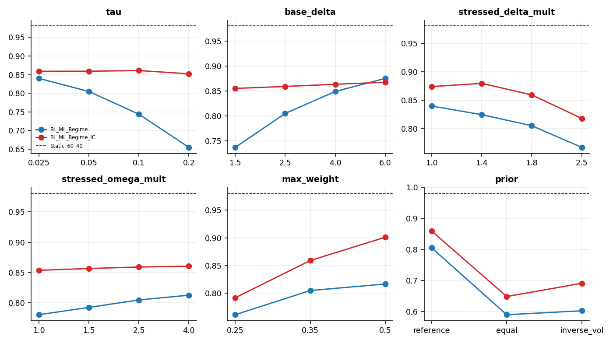

*Sharpe ratio across parameter settings*

Each prior against the portfolio that simply holds it:

| Prior | Variant | Sharpe | Sharpe_PriorPortfolio | Diff | CI_low | CI_high | p_value | MaxDrawdown | MaxDrawdown_PriorPortfolio |
|---|---|---|---|---|---|---|---|---|---|
| reference | BL_ML_Regime | 0.805 | 0.927 | -0.122 | -0.309 | 0.040 | 0.175 | -0.161 | -0.211 |
| reference | BL_ML_Regime_IC | 0.859 | 0.927 | -0.068 | -0.197 | 0.046 | 0.291 | -0.131 | -0.211 |
| reference | BL_HistMean_Regime | 0.894 | 0.927 | -0.033 | -0.194 | 0.110 | 0.678 | -0.153 | -0.211 |
| equal | BL_ML_Regime | 0.590 | 0.744 | -0.154 | -0.320 | -0.010 | 0.053 | -0.177 | -0.236 |
| equal | BL_ML_Regime_IC | 0.648 | 0.744 | -0.096 | -0.225 | 0.025 | 0.137 | -0.153 | -0.236 |
| equal | BL_HistMean_Regime | 0.651 | 0.744 | -0.093 | -0.249 | 0.052 | 0.241 | -0.169 | -0.236 |
| inverse_vol | BL_ML_Regime | 0.602 | 0.751 | -0.149 | -0.364 | 0.027 | 0.141 | -0.143 | -0.174 |
| inverse_vol | BL_ML_Regime_IC | 0.691 | 0.751 | -0.060 | -0.201 | 0.069 | 0.403 | -0.110 | -0.174 |
| inverse_vol | BL_HistMean_Regime | 0.693 | 0.751 | -0.058 | -0.250 | 0.103 | 0.532 | -0.134 | -0.174 |

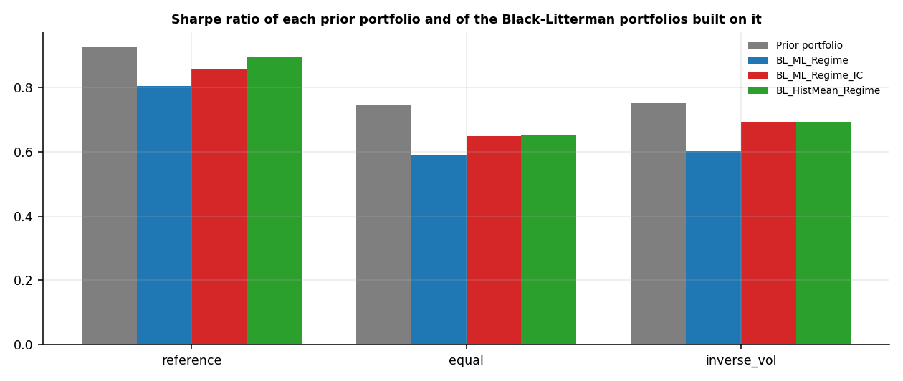

*Prior portfolios and the Black-Litterman portfolios built on them*

### 5.11 Frozen specification and new months

| freeze_date | spec_hash | spec_unchanged | months_since_freeze | inference_possible |
|---|---|---|---|---|
| 2026-07-31 | 7864aea1afd47cd0 | True | 0 | False |

No realised months have been added since the freeze date.

## 6. Discussion

The research hypothesis is not supported. The highest Sharpe ratio among the Kairos portfolios and the classical benchmarks belongs to Static_60_40. The Sharpe difference of BL_ML_Regime to the best classical benchmark (Static_60_40) is -0.18 (95% interval -0.43 to 0.03, p = 0.135), not statistically significant; BL_ML_Regime is significantly better than 1 and significantly worse than 0 of the 5 classical benchmarks (5% level). For BL_ML_Regime_IC the difference is -0.12 (95% interval -0.34 to 0.05, p = 0.216), not statistically significant.

The forecasting layer is the weak link: the original stacked ensemble has a mean out-of-sample information coefficient of -0.061. 2 of 9 assets show an IC that is significantly negative at the 5% level (SPY, EFA) and 0 show one that is significantly positive. The original stacked ensemble beats the mean of the single models on 2 of 9 assets. Measured against an expanding historical-mean forecast, the original stacked ensemble has a negative out-of-sample R2 on 9 of 9 assets (mean -0.096), and across all models and assets 53 of 54 model-asset R2 values are negative. Hit rates flatter the models: for SPY the original stacked ensemble calls an up month in 82% of months and is right 60.2% of the time, while SPY rose in 68.7% of months, so an always-up rule would have scored higher. The stacked hit rate is below the always-up baseline on 9 of 9 assets.

The LSTM trained on raw monthly returns produced forecasts about 1.9 times as variable as realised returns (mean R2 -3.8). Scaling the training target by its training mean and standard deviation brings the ratio to 0.34 and the mean R2 to -0.16. Two pooled cross-asset models, a convex stacker that includes the historical mean as a candidate, and a causal calibration that shrinks the stacked forecast toward the historical mean by the trailing 36-month slope were added. Mean R2 against the historical mean is -0.016 for the calibrated forecast, against -0.096 for the original stacked ensemble. Before 2019-01-01 the values are -0.025 and -0.107; from 2019-01-01 they are -0.014 and -0.093. IC is not informative for a forecast that is mostly the historical mean, so R2 is the metric used here. No forecast, single model or ensemble, has a positive mean R2 in either period, so the repairs remove the harm done by badly scaled forecasts but do not create skill. The calibrated forecast behaves almost like the historical mean, which remains the best return forecast in this sample.

One candidate explanation is that the first 48 months of training are dominated by 2008. For SPY, the rank correlation between the filtered stress probability and the next-month return is -0.23 in the initial training window and +0.21 afterwards, and the sign differs between the two windows for 6 of 9 assets. For SPY this is consistent with models learning a stress-precedes-losses rule from the crisis that the rebounds of later years then contradicted. Re-fitting the tree and linear models under 4 alternative designs on the dates common to all designs gives a mean IC across assets of -0.011 as specified, then no regime features -0.020; no stress features +0.002; longer initial window -0.011; no regime longer window -0.020. The largest improvement comes from the no stress features design (+0.012). The R2 against the historical mean stays negative under every design, so no design yields a forecast that beats the historical mean, and the weak skill is not simply an artefact of the regime features or the initial window. It points to a weak and unstable one-month return signal. Choosing a design after seeing out-of-sample results is a post hoc choice, so the pipeline keeps the specified design and treats this only as a diagnostic that needs fresh data to confirm.

The decisive ablation applies a mechanical version of the same stress rule (risky weights divided by 1.8, the remainder in cash) to benchmarks that use no forecasts. On static 60/40 it moves the Sharpe ratio from 0.98 to 0.98 (difference -0.001, p = 0.994) and the maximum drawdown from -20.5% to -13.1%. On the market reference the Sharpe ratio moves from 0.93 to 0.91 (p = 0.795) and the drawdown from -21.1% to -13.6%. The best overlay (Regime_60_40) has a Sharpe ratio of 0.98, against 0.80 for BL_ML_Regime and 0.86 for BL_ML_Regime_IC. Neither forecast-driven portfolio exceeds a rule that needs no forecasts (paired Sharpe differences -0.17 and -0.12, p = 0.12 and 0.17), so the machine learning and Black-Litterman machinery shows no measurable benefit beyond the defensive exposure cut. With the original, uncalibrated views the Sharpe ratio is 0.74, and the Sharpe difference of the calibrated BL_ML_Regime to it is +0.06 (95% interval -0.10 to 0.22, p = 0.465), not statistically significant. Black-Litterman with naive historical-mean views scores 0.89, and the Sharpe difference of BL_ML_Regime to it is -0.09 (95% interval -0.15 to -0.04, p = 0.003), statistically significant at the 5% level, so the machine learning views do not improve on naive ones inside the same allocator.

The regime layer does reduce risk. BL_ML_Regime has a maximum drawdown of -16.1% against -22.7% without regime scaling, although the Sharpe gain is not significant. The cost shows in months flagged stressed at the decision date: BL_ML_Regime earned 8.7% annualised in those months, against 16.4% for Market_Reference and 17.7% for Equal_Weight. Stress flags in this sample were typically followed by rebounds, so cutting exposure protects capital in the drawdown but gives up return in the recovery.

The main backtest starts in January 2009, after the crisis trough, so it covers a long equity bull market that favours benchmarks with a high equity weight and leaves the 2008 drawdown outside the main window; the crisis-inclusive window below adds it. The Sharpe ratio of static 60/40 is 1.47 in the first half of the sample and 0.66 in the second, and 12 of 12 strategies show a lower Sharpe ratio in the second half, so conclusions about relative performance depend on the period.

Splitting the sample at 2019-01-01 gives Sharpe ratios of BL_ML_Regime 0.89 before and 0.74 from 2019-01-01; Static_60_40 1.30 before and 0.71 from 2019-01-01; Regime_60_40 1.31 before and 0.70 from 2019-01-01. In the later period the Sharpe difference between BL_ML_Regime and static 60/40 is +0.03 (95% interval -0.25 to 0.26, p = 0.779), not statistically significant. This split is a reporting device, not a clean test: the repairs were motivated by full-sample diagnostics, so only months that arrive after the freeze date are untouched.

A crisis-inclusive window starts the out-of-sample forecasts in 2007-01-31 with a 24-month initial training period, which adds the 2008 crisis to the test (235 months). In that window Static_60_40 has a Sharpe ratio of 0.72 and a maximum drawdown of -29.5%, Regime_60_40 has 0.77 and -16.6%, and BL_ML_Regime has 0.69 and -17.2%. The Sharpe difference between the overlay and plain 60/40 is +0.06 (95% interval -0.09 to 0.19, p = 0.433), not statistically significant. BL_ML_Regime against the overlay: -0.08 (95% interval -0.31 to 0.11, p = 0.430), not statistically significant.

BL_ML_Regime_IC has the highest Sharpe ratio of the three Kairos variants, but it is the best of several variants tried on one sample (five counting the raw-view and historical-mean ablations) and should be read as exploratory. Its deflated Sharpe ratio gives a probability of 0.999 that the true Sharpe ratio is positive after allowing for 5 trials and 0.999 after allowing for 10. This tests the Sharpe ratio against zero, not against 60/40, so it does not contradict the paired comparisons above. Against its sibling BL_ML_Regime the Sharpe difference is +0.05 (95% interval -0.07 to 0.18, p = 0.387), not statistically significant.

Across 44 one-at-a-time parameter changes (tau, base_delta, stressed_delta_mult, stressed_omega_mult, max_weight, prior), the Sharpe ratio ranges BL_ML_Regime from 0.59 to 0.88 and BL_ML_Regime_IC from 0.65 to 0.90, against 0.98 for Static_60_40, and 0 of 44 runs exceed the 60/40 value. No setting in the grid closes the gap, so the shortfall is not a tuning artefact. An equal-weight prior in place of the reference allocation gives 0.59 and 0.65.

The Sharpe ratio of a Black-Litterman portfolio depends on the prior, because each prior is a different starting portfolio, so the right comparison is against that prior's own portfolio. The Sharpe difference of BL_ML_Regime to its prior portfolio is: reference -0.12 (p = 0.17); equal -0.15 (p = 0.05); inverse_vol -0.15 (p = 0.14). No prior shows a significant gain, so the Black-Litterman layer adds little beyond the prior it starts from. No observed market-capitalisation series is bundled, because none could be sourced for these exchange-traded funds without hand-picking splits; the pipeline accepts one in data/raw/prior_weights.csv and then adds it to this comparison.

The specification is frozen as of 2026-07-31 (hash 7864aea1afd47cd0). 0 realised months have been added since then, so there is no confirmatory evidence yet. Re-run with refreshed data to evaluate months as they arrive.

## 7. Limitations

Monthly data gives roughly 15 years of observations in the main window and about 20 in the crisis-inclusive window, which limits statistical power, so wide intervals should be read as inconclusive rather than as evidence of equivalence. The default prior is a hand-picked reference allocation (SPY 42%, IEF 15%, EFA 12%, TLT 10%, GLD 8%, DBC 5%, HYG 5%, BTC-USD 2%, ETH-USD 1%), not an observed market-capitalisation series. The inverse-volatility and equal-weight priors remove the judgement but are not market-implied either. The stress rule is calibrated by hand (multipliers fixed in advance) and the validation windows were chosen with hindsight, although they are not used in fitting. The forecast repairs and the diagnostics were designed after seeing full-sample results, so the development and holdout split is a reporting device and only months realised after the freeze date are untouched evidence. The LSTM is a small NumPy implementation refit every six months. Yahoo adjusted closes are retrospective vendor data and can be revised. The data stage needs network access to Yahoo Finance for a fresh download; later runs reuse the cache, and the manifest in section 3 allows the cached series to be checked. Results hold for this universe and period.

## 8. Reproducibility

Run `python scripts/run.py all` to download data, run every stage and rebuild this report, or `python scripts/run.py all --refresh` to download fresh prices first. Seeds, parameters and paths are in `code/kairos/config.py`.
